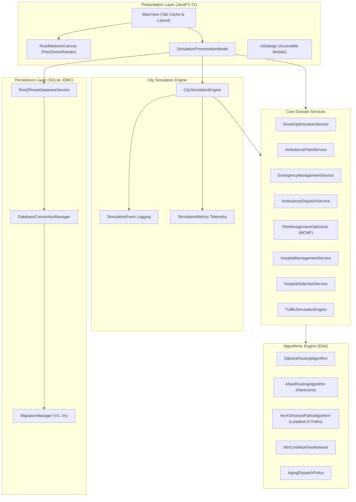

# ResQRoute — Emergency Ambulance Dispatch & Intelligent Routing Engine

[](https://openjdk.org/projects/jdk/21/)
[](https://openjfx.io/)
[](https://github.com/xerial/sqlite-jdbc)
[](https://junit.org/junit5/)
[](#testing--verification)

> **ResQRoute** is a deterministic emergency response dispatch and dynamic routing system designed for urban emergency services. Built in Java 21 and JavaFX, it combines graph-theoretic pathfinding (Dijkstra, A\*, Yen's K-Shortest Paths), queue-aging triage dispatch, Min-Cost Max-Flow (MCMF) fleet optimization, real-time traffic incident simulation, and an embedded ACID-compliant SQLite persistence layer.

---

## Table of Contents
1. [Real-World Problem Statement](#real-world-problem-statement)
2. [Key Features & Algorithmic Capabilities](#key-features--algorithmic-capabilities)
3. [System Architecture](#system-architecture)
4. [Technology Stack & Prerequisites](#technology-stack--prerequisites)
5. [Quick Start & Setup Instructions](#quick-start--setup-instructions)
6. [Interactive Application Walkthrough](#interactive-application-walkthrough)
7. [Algorithmic Complexity & Performance Analysis](#algorithmic-complexity--performance-analysis)
8. [Testing & Verification](#testing--verification)
9. [Limitations & Future Roadmap](#limitations--future-roadmap)
10. [License](#license)

---

## Real-World Problem Statement

In metropolitan emergency medical services (EMS), response latency directly impacts patient survival rates. Traditional dispatch engines often suffer from three critical bottlenecks:
1. **Static Routing & Traffic Blindness:** Ambulances are dispatched along static shortest paths, encountering unpredicted road closures and heavy congestion.
2. **Greedy Dispatch Contention:** Greedily assigning the closest available ambulance to the first incoming call often starves subsequent critical incidents (e.g., cardiac arrest or major trauma) of specialized units (Advanced Life Support, Cardiac Care).
3. **Queue Starvation:** Standard priority queues can leave moderate-severity incidents unserved indefinitely during high-call-volume spikes.

**ResQRoute** solves these challenges by combining:
- **Heuristic Goal-Directed Pathfinding (A\*)** with speed-bounded Haversine distance heuristics for sub-millisecond route generation.
- **Yen's K-Shortest Loopless Paths Algorithm** for instant detour calculation during sudden arterial road closures.
- **Global Min-Cost Max-Flow Fleet Optimization** to minimize global priority-weighted response times across competing incidents.
- **Starvation-Free Aging Priority Queue** that dynamically escalates incident priority based on elapsed waiting time.

---

## Key Features & Algorithmic Capabilities

### 1. Advanced Graph Routing Engine
- **Dijkstra's Algorithm:** Calculates single-source fastest routes based on dynamic road travel times.
- **A\* Search with Admissible Haversine Heuristic:** Employs $h(n) = (\text{haversine}(n, \text{goal}) / v_{\max}) \times 60$, achieving 100% path optimality match with Dijkstra while pruning unpromising search spaces.
- **Yen's K-Shortest Paths Algorithm:** Generates $K$ loopless alternative paths ($K \in \{2, 3, 5\}$) to provide detours around high-congestion arteries or emergency incidents.
- **Dynamic Traffic & Incident Rerouting:** Real-time updates to edge weights (Free Flow, Moderate, Heavy, Severe, Closed) with automatic rerouting for vehicles in transit.

### 2. Intelligent Ambulance Fleet Management & Dispatch
- **Vehicle Capabilities & Care Tiers:** Supports Basic Life Support (BLS), Advanced Life Support (ALS), Cardiac Care, Neonatal Care, and Heavy Rescue units.
- **Starvation-Free Queue (`AgingDispatchPolicy`):** Dynamically escalates queued emergency priority over wait time to ensure fair service for all triage tiers.
- **Fleet-Wide Matching (`FleetAssignmentOptimizer`):** Solves a bipartite Min-Cost Max-Flow problem to determine globally optimal unit-to-incident assignments.

### 3. Hospital Selection & Bed Reservation Protocol
- Evaluates regional healthcare facilities by distance, travel time, medical capability suitability (Trauma Center, ICU, Cath Lab), and live bed capacity.
- Atomically reserves bed capacity when patients are in transit and releases reservations upon treatment completion.

### 4. Interactive Desktop Visualization (JavaFX 21)
- **Live Canvas Map:** High-performance vector rendering of road networks with pan, zoom, fit-to-screen, and click-to-inspect tools.
- **Smooth Vehicle Animation:** Interpolates ambulance markers along assigned road paths with live heading angles, ETAs, and progress bars.
- **Accessible Design:** Non-color-dependent status badges (`⛔ [CRITICAL]`, `▲ [HIGH]`, `● [MEDIUM]`, `○ [LOW]`), visible focus indicators (`:focused`), accessible text, tooltips, and keyboard navigation (`Alt+1..7`).

### 5. Embedded Persistence Layer (SQLite JDBC)
- Fully normalized relational schema with ACID guarantees, foreign-key cascade protections, and index-accelerated queries.
- Versioned database migrations (`V1__initial_schema.sql`).
- Asynchronous `CompletableFuture` data access preventing any blocking on the JavaFX Application Thread.

---

## System Architecture



Detailed architectural diagrams and workflows are documented in [docs/architecture/architecture.md](docs/architecture/architecture.md).

---

## Technology Stack & Prerequisites

- **Language:** Java 21 (LTS) (utilizing Pattern Matching, Records, Sequenced Collections).
- **GUI Framework:** OpenJFX (JavaFX) 21.0.2.
- **Build & Dependency Management:** Apache Maven 3.9+.
- **Database:** SQLite 3.45.1.0 via `org.xerial:sqlite-jdbc`.
- **Testing:** JUnit 5 (Jupiter 5.10.2).

### Prerequisites:
- JDK 21 installed (`java -version` returns 21+).
- Maven 3.8+ installed (`mvn -version`).

---

## Quick Start & Setup Instructions

### 1. Clone the Repository
```bash
git clone https://github.com/Shyaman014/ResQRoute.git
cd ResQRoute
```

### 2. Build the Project
```bash
mvn clean compile
```

### 3. Run the Automated Test Suite (464 Tests)
```bash
mvn test
```

### 4. Launch the Interactive Application
```bash
mvn javafx:run
```
*(Or via `mvn exec:java`)*

---

## Interactive Application Walkthrough

The application features 7 synchronized views accessible via the sidebar or keyboard shortcuts:

| Shortcut | View | Key Functionality |
|:---:|:---|:---|
| `Alt+1` | **Dashboard** | High-level fleet readiness, critical emergency queue, bed availability stat cards, quick simulation controls, and audit event feed. Double-click table rows to inspect full entity details. |
| `Alt+2` | **City Map** | Interactive vector canvas showing nodes, roads, traffic congestion levels, calculated routes, and animated ambulances in transit. Includes Route Planner, Fleet Telemetry, Entity Inspector, and Incident Manager tabs. |
| `Alt+3` | **Emergencies** | Active emergency queue with search filtering, triage classification badges, lifecycle tracking, and detail modals. |
| `Alt+4` | **Ambulances** | Fleet unit readiness, spatial location, assigned emergency mission, and medical equipment capabilities. |
| `Alt+5` | **Hospitals** | Healthcare facility capacity bars, available beds, supported triage categories, and clinical capabilities. |
| `Alt+6` | **Simulation** | Fine-grained discrete time stepper (`+10s`, `+30s`, `+1m`, `+5m`), playback speed multipliers (`0.25x` to `4.0x`), scenario metadata, and full event log. |
| `Alt+7` | **Settings** | Deterministic random seed calibration, step duration adjustments, and underlying architectural specifications. |

---

## Algorithmic Complexity & Performance Analysis

ResQRoute contains an isolated statistical microbenchmark suite measuring performance across synthetic planar road networks (Small: 50 nodes, Medium: 250 nodes, Large: 1,000 nodes). All benchmarks feature HotSpot JIT warm-up cycles and nanosecond timing.

### Verified Benchmark Results (Windows 11 AMD64, 16 Cores, Java 21):

| Algorithm / Operation | Network Scale | Mean Latency | Median Latency | Throughput | Diagnostics |
|:---|:---|---:|---:|---:|:---|
| **Dijkstra Routing** | Small (50 nodes, 20 pairs) | 471.72 $\mu$s | 426.90 $\mu$s | 2,119.9 ops/sec | 100% Optimality Match |
| **A\* Routing (Haversine)** | Small (50 nodes, 20 pairs) | 416.93 $\mu$s | 354.10 $\mu$s | 2,398.5 ops/sec | 100% Optimality Match |
| **Yen's K-Shortest (K=2)** | Small (50 nodes) | 277.13 $\mu$s | 256.40 $\mu$s | 3,608.5 ops/sec | Loopless Detour Path |
| **Yen's K-Shortest (K=5)** | Large (1,000 nodes) | 16.60 ms | 15.97 ms | 60.2 ops/sec | 5 Alternative Paths |
| **Greedy Dispatch** | Small (10 amb, 10 cases) | 11.19 $\mu$s | 2.50 $\mu$s | 89,392.1 ops/sec | Greedy Nearest-Neighbor |
| **Fleet Optimizer (MCMF)**| Small (10 amb, 10 cases) | 2.54 ms | 2.61 ms | 394.1 ops/sec | Global Minimum Travel Cost |
| **Hospital Selection** | Medium (15 hospitals) | 662.16 $\mu$s | 655.50 $\mu$s | 1,510.2 ops/sec | Capability + Bed Filtering |
| **Graph Node Lookup** | Large (1,000 nodes) | 4.39 $\mu$s | 2.90 $\mu$s | 227,963.5 ops/sec | $O(1)$ Hash Map Retrieval |
| **Dynamic Traffic Update** | Large (1,000 nodes) | 3.00 $\mu$s | 0.50 $\mu$s | 333,333.3 ops/sec | $O(1)$ In-place Edge Mutation |

Complete experimental setup and hardware specifications are available in [docs/benchmarks/benchmark_report.md](docs/benchmarks/benchmark_report.md).

### Reproduce Benchmarks:
```bash
# Fast smoke benchmark (< 2 seconds)
mvn test-compile "exec:java" "-Dexec.classpathScope=test" "-Dexec.mainClass=com.resqroute.benchmark.BenchmarkRunner" "-Dexec.args=--smoke"

# Full statistical benchmark across Small, Medium, and Large networks
mvn test-compile "exec:java" "-Dexec.classpathScope=test" "-Dexec.mainClass=com.resqroute.benchmark.BenchmarkRunner"
```

---

## Testing & Verification

The project enforces strict software reliability principles across **464 automated unit and integration tests**:
- **Unit Tests:** Graph structures, Dijkstra, A*, Yen's algorithm, priority queue aging, hospital evaluation, database repositories, and migrations.
- **Integration Tests:** Complete emergency lifecycle from 911 call reporting to dispatch, transit, hospital handoff, and dynamic mid-route rerouting during road closures.
- **Reliability Tests:** Domain boundary validations, error handling, concurrent transactions, and graceful recovery.

Run the test suite:
```bash
mvn clean test
```
*Result: 464 tests run, 0 failures, 0 errors, 0 skipped (Build Time: ~12-14 seconds).*

---

## Limitations & Future Roadmap

- **Graph Topology:** Currently evaluates synthetic planar grid-mesh networks; future releases will support importing OpenStreetMap (OSM) `.pbf` XML road networks.
- **Multi-Vehicle Collision:** The simulation currently models dynamic congestion via edge travel time multipliers; full microscopic car-following models (e.g. IDM) are targeted for future expansion.
- **Distributed Fleet Coordination:** Planned support for WebSocket-based live telemetry broadcast to multiple remote dispatch terminals.

---

## License

This project is licensed under the MIT License. See the [LICENSE](LICENSE) file for details.