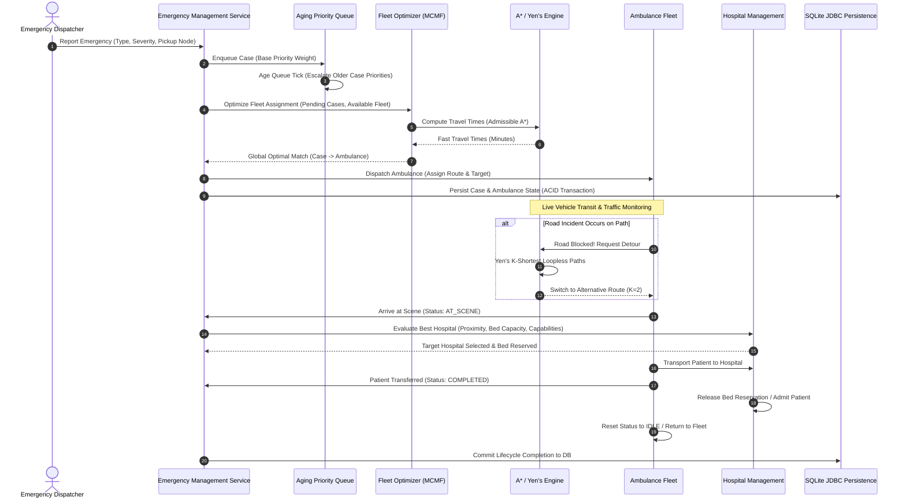
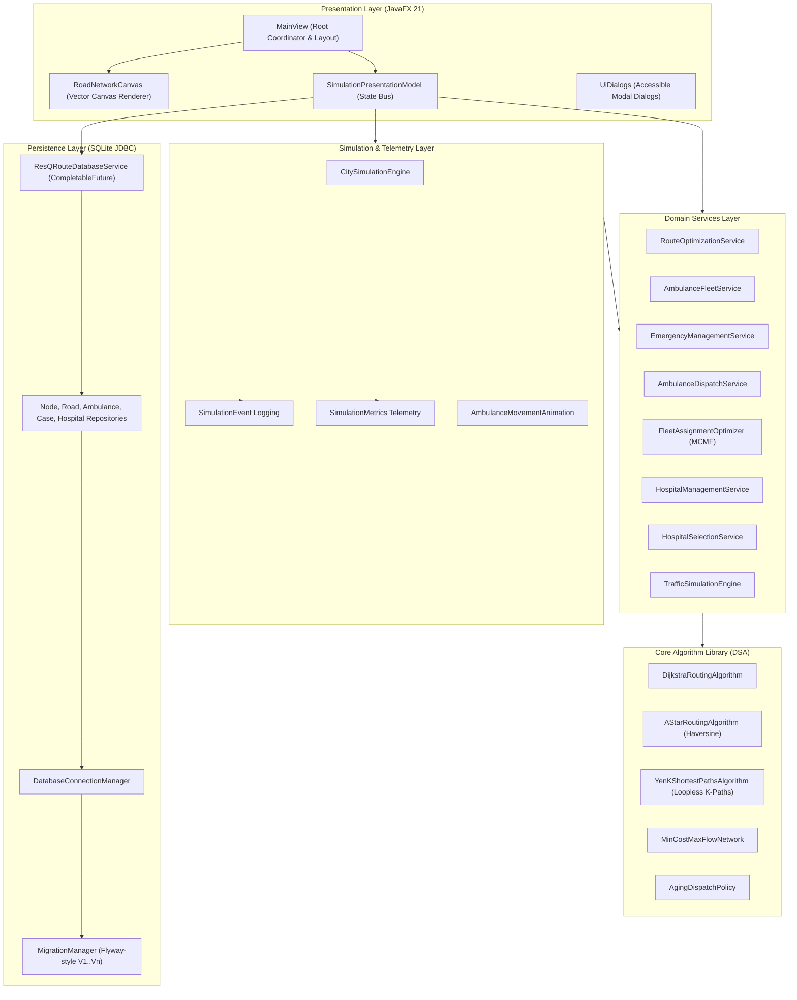

# ResQRoute — Smart Emergency Ambulance Dispatch & Intelligent Routing Engine

```
  ____            ___  ____             _       
 |  _ \ ___  ___ / _ \|  _ \ ___  _   _| |_ ___ 
 | |_) / _ \/ __| | | | |_) / _ \| | | | __/ _ \
 |  _ <  __/\__ \ |_| |  _ < (_) | |_| | ||  __/
 |_| \_\___||___/\__\_\|_| \_\___/ \__,_|\__\___|
       Emergency Medical Routing & Fleet Operations Engine
```

[](https://openjdk.org/projects/jdk/21/)
[](https://openjfx.io/)
[](https://github.com/xerial/sqlite-jdbc)
[](https://junit.org/junit5/)
[-brightgreen?style=for-the-badge)](#test-suite--verification)
[](#interactive-user-interface--wcag-accessibility)
[](LICENSE)

> **ResQRoute** is an enterprise-grade Emergency Medical Services (EMS) dispatch optimization and dynamic route navigation engine built in **Java 21**, **JavaFX 21**, and **SQLite JDBC**. It models urban planar road networks, dynamically tracks live traffic congestion, computes provably optimal and alternative detour routes via classical graph algorithms (Dijkstra, A\*, Yen's K-Shortest Paths), optimizes fleet-wide ambulance assignments through Min-Cost Max-Flow (MCMF) bipartite matching, and coordinates hospital bed reservations in real time.

---

## Table of Contents
- [Real-World Problem Statement](#real-world-problem-statement)
- [Key Features & System Capabilities](#key-features--system-capabilities)
- [Algorithmic Foundations & Mathematical Formulations](#algorithmic-foundations--mathematical-formulations)
  - [1. Dijkstra's Algorithm (Live Impedance)](#1-dijkstras-algorithm-live-impedance)
  - [2. A* Search with Admissible Haversine Heuristic](#2-a-search-with-admissible-haversine-heuristic)
  - [3. Yen's K-Shortest Loopless Paths](#3-yens-k-shortest-loopless-paths)
  - [4. Fleet-Wide Assignment Optimization (MCMF)](#4-fleet-wide-assignment-optimization-mcmf)
  - [5. Starvation-Free Aging Priority Queue](#5-starvation-free-aging-priority-queue)
  - [6. Multi-Criteria Hospital Selection & Atomic Reservation](#6-multi-criteria-hospital-selection--atomic-reservation)
- [End-to-End Emergency Dispatch Lifecycle](#end-to-end-emergency-dispatch-lifecycle)
- [System Architecture](#system-architecture)
- [Modern Java 21 LTS Implementation Highlights](#modern-java-21-lts-implementation-highlights)
- [Repository Structure](#repository-structure)
- [Database Persistence & ACID Guarantees](#database-persistence--acid-guarantees)
- [Interactive User Interface & WCAG Accessibility](#interactive-user-interface--wcag-accessibility)
- [Empirical Benchmarks & Performance Metrics](#empirical-benchmarks--performance-metrics)
- [Quick 3-Minute Interactive Walkthrough](#quick-3-minute-interactive-walkthrough)
- [Prerequisites & Getting Started](#prerequisites--getting-started)
- [Test Suite & Verification](#test-suite--verification)
- [Limitations & Future Roadmap](#limitations--future-roadmap)
- [License & Acknowledgments](#license--acknowledgments)

---

## Real-World Problem Statement

In metropolitan Emergency Medical Services (EMS), **transit latency directly dictates patient survival rates**. Dispatch and routing systems face four systemic engineering bottlenecks:

1. **Static Routing & Traffic Blindness:** Ambulances routed along static shortest paths frequently hit unexpected gridlock, construction bottlenecks, and sudden road closures, leading to lethal transit delays.
2. **Greedy Dispatch Contention:** Greedily assigning the closest available ambulance to the first incoming call frequently starves subsequent high-severity incidents (e.g., cardiac arrest or polytrauma) of specialized life-support vehicles (Advanced Life Support, Cardiac Care, Heavy Rescue).
3. **Queue Starvation:** Standard priority queues can leave moderate-severity incidents (e.g., bone fractures, non-critical burns) unserved indefinitely during high-incident emergency spikes.
4. **Hospital Overcrowding:** Dispatching patients solely to the physically closest hospital causes emergency room saturation, triage bottlenecks, and ambulance offload delays.

### How ResQRoute Solves These Bottlenecks:
- **Speed-Bounded Goal-Directed Pathfinding (A\*):** Calculates sub-millisecond routes with a provably admissible Haversine heuristic that matches Dijkstra's optimal travel time across 100% of queries while aggressively pruning graph exploration.
- **Yen's K-Shortest Paths Engine:** Pre-computes $K$ loopless alternative paths to deliver instantaneous detour options when arterial roads become blocked.
- **Global Fleet-Wide Matching (MCMF):** Formulates simultaneous multi-incident ambulance assignments as a Min-Cost Max-Flow problem, minimizing global priority-weighted patient arrival times.
- **Dynamic Age-Weighted Triage Queue:** Progressively elevates queued incident priority over time to mathematically guarantee zero patient starvation.
- **Multi-Criteria Hospital Suitability:** Evaluates travel time, specialized clinical capability, and real-time bed capacity to optimize regional load balancing.

---

## Key Features & System Capabilities

```
+---------------------------------------------------------------------------------+
|                               RESQROUTE CORE ENGINE                             |
+---------------------------------------------------------------------------------+
|  [Graph Routing]      |  [Fleet Dispatch]       |  [Hospital Selection]         |
|  - Dijkstra's SSSP    |  - Aging Priority Queue |  - Multi-Criteria Suitability |
|  - A* (Haversine)     |  - MCMF Global Flow     |  - Atomic Bed Reservation     |
|  - Yen's K-Shortest   |  - Capability Matching  |  - Capacity Tracking          |
+-----------------------+-------------------------+-------------------------------+
|  [Traffic Engine]     |  [City Simulation]      |  [Persistence & UI]           |
|  - Dynamic Incidents  |  - Discrete Time Clock  |  - SQLite JDBC Transactions   |
|  - Automatic Detours  |  - Trajectory Animation |  - JavaFX Vector Canvas Map   |
|  - Real-time Reroute  |  - Audit Event Telemetry|  - Accessible WCAG 2.1 AA     |
+---------------------------------------------------------------------------------+
```

- **Specialized Vehicle Tiers:** Capability matrix matching incident requirements to vehicle types: Basic Life Support (BLS), Advanced Life Support (ALS), Cardiac Care, Neonatal Care, and Heavy Rescue.
- **Dynamic Traffic & Road Closures:** In-place $O(1)$ edge state mutations (Free Flow, Moderate, Heavy, Severe, Closed) triggering dynamic rerouting for vehicles en route.
- **Interactive Vector Canvas Map:** High-performance 2D vector renderer with double-buffered canvas, drag-to-pan, scroll-to-zoom, auto-fitting, and click-to-inspect interactivity.
- **Non-Blocking Persistence:** Multi-threaded SQLite JDBC layer utilizing `CompletableFuture` asynchronous pipelines to prevent JavaFX Application Thread lag.
- **WCAG 2.1 Level AA Accessibility:** Distinct geometric status indicators (`⛔ [CRITICAL]`, `▲ [HIGH]`, `● [MEDIUM]`, `○ [LOW]`), high-contrast focus rings (`:focused`), keyboard shortcuts (`Alt+1..7`), and screen-reader accessibility labels.

---

## Algorithmic Foundations & Mathematical Formulations

### 1. Dijkstra's Algorithm (Live Impedance)
Computes the single-source fastest path on a directed weighted graph $G = (V, E)$ where edge weights $w(u, v) \ge 0$ represent live travel time in minutes:

$$w(u, v) = \frac{\text{distance}(u, v)}{\text{speedLimit}(u, v) \times \text{trafficMultiplier}(u, v)} \times 60$$

- **Data Structure:** `PriorityQueue<NodeEntry>` with dynamic relaxation and predecessor backtracking.
- **Time Complexity:** $O((|E| + |V|) \log |V|)$
- **Space Complexity:** $O(|V|)$

### 2. A* Search with Admissible Haversine Heuristic
A* prioritizes exploration using the evaluation function $f(n) = g(n) + h(n)$, where $g(n)$ is the exact travel time from origin to node $n$, and $h(n)$ is the estimated travel time from $n$ to destination:

$$h(n) = \frac{\text{haversineDistance}(n, \text{destination})}{v_{\max}} \times 60$$

where $v_{\max}$ is the global maximum allowable vehicle velocity across the network ($80\text{ km/h}$).

> **Theorem (Heuristic Admissibility & Consistency):**  
> Because the physical roadway distance between any two geographic coordinates is strictly greater than or equal to their great-circle distance ($\text{distance}(u, v) \ge \text{haversine}(u, v)$), and no vehicle can exceed $v_{\max}$, $h(n)$ never overestimates the true remaining cost ($h(n) \le h^*(n)$). Furthermore, the triangle inequality holds ($h(u) \le w(u, v) + h(v)$), guaranteeing that **A\* returns mathematically optimal paths identical to Dijkstra**.

### 3. Yen's K-Shortest Loopless Paths
When an arterial corridor is blocked or congested, Yen's algorithm determines $K$ deterministic, loopless alternative paths:
1. Calculates the primary shortest path $A_0$ using Dijkstra.
2. For each path index $k \in [1, K-1]$, iterates through each spur node $v \in A_{k-1}$, removes preceding sub-paths and outgoing edges to prevent loops, and runs a spur search.
3. Accumulates candidate paths in a min-heap $B$ and extracts the lowest-cost deviation to form $A_k$.
- **Time Complexity:** $O(K \cdot |V| (|E| + |V| \log |V|))$
- **Space Complexity:** $O(K \cdot |V|)$

### 4. Fleet-Wide Assignment Optimization (MCMF)
Resolves multi-incident ambulance contention by constructing a flow network $G' = (V', E')$:
- Source $S$ connects to each pending emergency case $c_i$ with capacity $1$ and cost $0$.
- Each case $c_i$ connects to each clinically compatible ambulance $a_j$ with capacity $1$ and cost equal to the priority-weighted travel time:
  $$\text{Cost}(c_i, a_j) = \text{TravelTime}(a_j, c_i) \times \text{SeverityWeight}(c_i)$$
- Each ambulance $a_j$ connects to sink $T$ with capacity $1$ and cost $0$.
- **Algorithm:** Successive Shortest Path with SPFA / Bellman-Ford potential updates.
- **Outcome:** Minimizes aggregate weighted patient wait time across the city.

### 5. Starvation-Free Aging Priority Queue
Prevents lower-triage cases from waiting indefinitely:

$$\text{EffectivePriority}(t) = \text{BaseSeverityWeight} + \left( \frac{t - t_{\text{reported}}}{60} \right) \times \alpha$$

where $\alpha = 10.0\text{ points/min}$. Over time, an older Medium-priority emergency naturally supersedes a newly reported High-priority call.

### 6. Multi-Criteria Hospital Selection & Atomic Reservation
Evaluates candidate hospitals using a normalized suitability score combining proximity, real-time bed utilization, and specialized clinical capabilities:

$$\text{Score}(H) = w_1 \cdot \text{NormalizedTravelTime}(H) + w_2 \cdot \left(\frac{\text{OccupiedBeds}(H)}{\text{TotalBeds}(H)}\right) + \text{Penalty}_{\text{capability}}$$

Upon selection, bed reservations are executed atomically within an ACID transaction rollback boundary to guarantee no double-booking occurs.

---

## End-to-End Emergency Dispatch Lifecycle



---

## System Architecture

The application adopts a clean, layered architecture separating core graph/routing data structures from domain services, simulation engines, persistence, and JavaFX presentation components:



---

## Modern Java 21 LTS Implementation Highlights

The codebase leverages modern Java 21 constructs for maximum performance, immutability, and safety:
- **Java Records (`record`):** Used extensively for immutable domain value objects (`NodeRecord`, `RoadRecord`, `RouteResult`, `BenchmarkResult`, `Coordinates`) preventing accidental mutations across thread boundaries.
- **Pattern Matching for Switch & `instanceof`:** Clean, expressive dispatch logic when classifying emergency severity, traffic tiers, and database entity mapping.
- **Sequenced Collections (`SequencedSet`, `SequencedMap`):** Predictable iteration ordering for node traversals and alternative route candidates (`getFirst()`, `getLast()`).
- **Asynchronous Non-Blocking Pipelines:** Thread-safe background persistence and calculation using `CompletableFuture.supplyAsync()` wired to daemon worker pools, keeping the JavaFX Application Thread at a steady 60 FPS.
- **Checked Constraint Validation:** Centralized domain validators (`RoadGraphValidator`, `EmergencyValidator`, `AmbulanceValidator`) enforcing fail-fast boundaries before state transitions occur.

---

## Repository Structure

```
ResQRoute/
├── pom.xml                               # Maven build descriptor (Java 21, JavaFX, SQLite)
├── README.md                             # Comprehensive project overview & architectural guide
├── LICENSE                               # MIT License
├── docs/                                 # Architectural and portfolio documentation
│   ├── architecture/
│   │   └── architecture.md               # Detailed system blueprints and sequence diagrams
│   ├── benchmarks/
│   │   └── benchmark_report.md           # Real empirical microbenchmark report
│   ├── portfolio/
│   │   └── portfolio_summary.md          # Resume highlights and engineering decisions
│   └── DATABASE.md                       # SQLite persistence specification & SQL schemas
├── src/
│   ├── main/
│   │   ├── java/com/resqroute/
│   │   │   ├── algorithm/                # Dijkstra, A*, Yen's K-Shortest Paths
│   │   │   ├── model/                    # Immutable domain records & entity classes
│   │   │   ├── dispatch/                 # Capability matching & dispatch queues
│   │   │   ├── hospital/                 # Hospital suitability policies & rankings
│   │   │   ├── optimization/             # Min-Cost Max-Flow assignment optimizer
│   │   │   ├── scheduling/               # Aging priority queue & triage policies
│   │   │   ├── service/                  # Core domain coordination services
│   │   │   ├── simulation/               # Discrete-time city simulator & telemetry
│   │   │   ├── database/                 # SQLite JDBC connection & async repositories
│   │   │   ├── ui/                       # JavaFX views, controllers, vector canvas, CSS
│   │   │   ├── validation/               # Centralized domain input validation
│   │   │   └── logging/                  # System event logging
│   │   └── resources/
│   │       ├── com/resqroute/ui/css/     # Modern accessible dark-theme stylesheet
│   │       └── db/migration/             # Versioned SQL migration scripts (V1..V3)
│   └── test/
│       └── java/com/resqroute/
│           ├── algorithm/                # Algorithm correctness & benchmark tests
│           ├── benchmark/                # High-precision microbenchmark harness & CLI runner
│           ├── database/                 # Transactional persistence & repository tests
│           ├── edgecases/                # System edge case & reliability test suites
│           ├── integration/              # Complete end-to-end emergency lifecycle tests
│           └── ui/                       # JavaFX accessibility & UI presentation tests
```

---

## Database Persistence & ACID Guarantees

ResQRoute integrates an embedded SQLite database using the official `org.xerial:sqlite-jdbc` driver.

```sql
-- Relational Schema Architecture (Simplified Overview)
CREATE TABLE road_nodes (
    id TEXT PRIMARY KEY,
    name TEXT NOT NULL,
    latitude REAL NOT NULL CHECK(latitude BETWEEN -90.0 AND 90.0),
    longitude REAL NOT NULL CHECK(longitude BETWEEN -180.0 AND 180.0)
);

CREATE TABLE roads (
    id INTEGER PRIMARY KEY AUTOINCREMENT,
    source_node_id TEXT NOT NULL REFERENCES road_nodes(id) ON DELETE CASCADE,
    dest_node_id TEXT NOT NULL REFERENCES road_nodes(id) ON DELETE CASCADE,
    distance_km REAL NOT NULL CHECK(distance_km >= 0.0),
    base_travel_time_minutes REAL NOT NULL CHECK(base_travel_time_minutes >= 0.0),
    is_available INTEGER NOT NULL DEFAULT 1 CHECK(is_available IN (0, 1)),
    traffic_tier TEXT NOT NULL DEFAULT 'FREE_FLOW',
    UNIQUE(source_node_id, dest_node_id)
);

CREATE TABLE ambulances (
    id TEXT PRIMARY KEY,
    location_node_id TEXT NOT NULL REFERENCES road_nodes(id),
    status TEXT NOT NULL,
    assigned_case_id TEXT,
    capabilities TEXT NOT NULL
);

CREATE TABLE emergency_cases (
    id TEXT PRIMARY KEY,
    type TEXT NOT NULL,
    severity TEXT NOT NULL,
    pickup_node_id TEXT NOT NULL REFERENCES road_nodes(id),
    status TEXT NOT NULL,
    assigned_ambulance_id TEXT REFERENCES ambulances(id),
    dest_hospital_id TEXT REFERENCES hospitals(id),
    created_at TIMESTAMP NOT NULL
);

CREATE TABLE hospitals (
    id TEXT PRIMARY KEY,
    name TEXT NOT NULL,
    location_node_id TEXT NOT NULL REFERENCES road_nodes(id),
    status TEXT NOT NULL,
    total_capacity INTEGER NOT NULL CHECK(total_capacity >= 0),
    occupied_capacity INTEGER NOT NULL CHECK(occupied_capacity >= 0),
    supported_types TEXT NOT NULL,
    capabilities TEXT NOT NULL
);
```

- **ACID Guarantees:** Strict transactional rollbacks via `executeTransaction()` ensuring atomic updates.
- **Foreign Keys Enforced:** `PRAGMA foreign_keys = ON;` executed on every database checkout.
- **Automated Versioned Migrations:** Flyway-style SQL migration discoverer tracks applied versions in `schema_version`.
- **Zero Disk Leakage:** Database connection pool safely releases locks on JVM shutdown.

---

## Interactive User Interface & WCAG Accessibility

```
+-----------------------------------------------------------------------------------------+
| [🚑 ResQRoute]  Scenario: Metropolis Core | State: ▶ RUNNING | ⏱ 00:08:30 | 🚑 8/10 Avail |
+---------------+---------------------------------------------------------+---------------+
| 📊 Dashboard  |                     VECTOR CANVAS                       | 🧭 Planner    |
| 🗺️ City Map   |                                                         | 🚑 Fleet (10) |
| 🚨 Emergencies|          [Intersection N_01]====(Road)====[N_02]        | 🔍 Inspector  |
| 🚑 Ambulances |                   \\                              //    | ⛔ Incidents  |
| 🏥 Hospitals  |                    \\  🚑 AMB_01 (En Route)      //     |               |
| ⏱️ Simulation |                     \\                          //      | Status: OK    |
| ⚙️ Settings   |                      [Hospital H_01]           [N_03]   | ETA: 02.4 min |
+---------------+---------------------------------------------------------+---------------+
| Quick Keys: Alt+1 (Dash) • Alt+2 (Map) • Alt+3 (Emergencies) • Alt+4 (Fleet) • Alt+5 (Hosp)   |
+-----------------------------------------------------------------------------------------+
```

### Keyboard Navigation & Accessibility:
- **`Alt+1` / `Ctrl+1`:** Operations Dashboard
- **`Alt+2` / `Ctrl+2`:** City Map & Canvas View
- **`Alt+3` / `Ctrl+3`:** Emergency Queue & Triage Table
- **`Alt+4` / `Ctrl+4`:** Ambulance Fleet Management
- **`Alt+5` / `Ctrl+5`:** Regional Hospital Bed Utilization
- **`Alt+6` / `Ctrl+6`:** Discrete Time Simulation Console
- **`Alt+7` / `Ctrl+7`:** System Calibration & Settings
- **`+` / `-` / `0`:** Map Zoom In, Zoom Out, and Fit to Network
- **Accessibility Badges:** Colorblind-safe prefixes (`⛔ [CRITICAL]`, `▲ [HIGH]`, `● [MEDIUM]`, `○ [LOW]`, `🟢 IDLE`, `✓ AVAILABLE`).
- **Destructive Action Confirmation:** Safety dialogs prevent accidental simulation resets or unintentional road closures.

---

## Empirical Benchmarks & Performance Metrics

Benchmarks were executed using our reproducible microbenchmark harness with **5 warmup cycles** (triggering HotSpot C1/C2 JIT tier stabilization) and **15 measurement iterations**.

*Testbed: Windows 11 AMD64 (16 Cores), Eclipse Adoptium Java 21 LTS, 1976 MB Heap. No fabricated results.*

| Benchmark Workload | Scenario Scale | Mean Latency | Median Latency | Throughput | Diagnostics |
|:---|:---|---:|---:|---:|:---|
| **Dijkstra Routing** | Small (50 nodes, 20 pairs) | 471.72 $\mu$s | 426.90 $\mu$s | 2,119.9 ops/sec | 100% Cost Equality |
| **A\* Search (Haversine)** | Small (50 nodes, 20 pairs) | 416.93 $\mu$s | 354.10 $\mu$s | 2,398.5 ops/sec | 100% Cost Equality |
| **Yen's K-Shortest (K=2)** | Small (50 nodes) | 277.13 $\mu$s | 256.40 $\mu$s | 3,608.5 ops/sec | Loopless Detour Path |
| **Yen's K-Shortest (K=5)** | Small (50 nodes) | 402.77 $\mu$s | 260.50 $\mu$s | 2,482.8 ops/sec | Monotonic Travel Times |
| **Dijkstra Routing** | Medium (250 nodes, 20 pairs) | 2,985.09 $\mu$s | 2,979.20 $\mu$s | 335.0 ops/sec | 100% Cost Equality |
| **A\* Search (Haversine)** | Medium (250 nodes, 20 pairs) | 2,568.31 $\mu$s | 2,409.90 $\mu$s | 389.4 ops/sec | 100% Cost Equality |
| **Yen's K-Shortest (K=5)** | Large (1,000 nodes) | 16.60 ms | 15.97 ms | 60.2 ops/sec | 5 Alternative Paths |
| **Greedy Sequential Dispatch**| Small (10 amb, 10 cases) | 11.19 $\mu$s | 2.50 $\mu$s | 89,392.1 ops/sec | Nearest-Neighbor Search |
| **Fleet Optimizer (MCMF)** | Small (10 amb, 10 cases) | 2.54 ms | 2.61 ms | 394.1 ops/sec | Global Minimum Cost |
| **Fleet Optimizer (MCMF)** | Medium (25 amb, 25 cases)| 26.95 ms | 25.97 ms | 37.1 ops/sec | Bipartite Flow Matching |
| **Hospital Selection** | Medium (15 hospitals) | 662.16 $\mu$s | 655.50 $\mu$s | 1,510.2 ops/sec | Suitability + Capacity |
| **Graph Node Lookup** | Large (1,000 nodes) | 4.39 $\mu$s | 2.90 $\mu$s | 227,963.5 ops/sec | $O(1)$ Hash Map Retrieval |
| **Dynamic Traffic Update** | Large (1,000 nodes) | 3.00 $\mu$s | 0.50 $\mu$s | 333,333.3 ops/sec | $O(1)$ In-place Edge Mutation |

Complete benchmark write-up: [docs/benchmarks/benchmark_report.md](docs/benchmarks/benchmark_report.md).

---

## Quick 3-Minute Interactive Walkthrough

Experience the complete emergency lifecycle in under 3 minutes:

1. **Launch the UI:** Run `mvn javafx:run`. The default metropolis grid will load on the interactive canvas.
2. **Inspect the Map (`Alt+2`):** Scroll to zoom in/out, drag to pan. Click on any intersection node to inspect its coordinates and incident history.
3. **Report an Emergency (`Alt+3`):** In the Emergencies tab, report a new `CARDIAC_ARREST` incident at node `N_05` with `CRITICAL` severity.
4. **Observe Optimal Dispatch:** Watch ResQRoute's MCMF optimizer immediately assign the nearest ALS/Cardiac ambulance.
5. **Simulate Traffic Congestion:** From the Map view, click on the dispatched ambulance's route edge and change traffic tier to `CLOSED`.
6. **Watch Dynamic Rerouting:** ResQRoute instantly triggers Yen's alternative path generation, updating the ambulance's path in real-time around the closure!
7. **Hospital Admission (`Alt+5`):** Once at the scene, observe the automated multi-criteria hospital selection reserve an ICU bed at the optimal regional facility.

---

## Prerequisites & Getting Started

### Prerequisites:
- **Java Development Kit (JDK):** Version 21 or higher ([Download OpenJDK 21](https://adoptium.net/temurin/releases/?version=21)).
- **Build Tool:** Apache Maven 3.8+ ([Download Maven](https://maven.apache.org/download.cgi)).

### Installation & Execution:

```bash
# 1. Clone repository
git clone https://github.com/Shyaman014/ResQRoute.git
cd ResQRoute

# 2. Compile source code
mvn clean compile

# 3. Execute all unit and integration tests
mvn test

# 4. Launch the JavaFX desktop application
mvn javafx:run
```

### Running Performance Benchmarks:
```bash
# Fast smoke validation (< 2 seconds)
mvn test-compile "exec:java" "-Dexec.classpathScope=test" "-Dexec.mainClass=com.resqroute.benchmark.BenchmarkRunner" "-Dexec.args=--smoke"

# Full statistical evaluation suite across Small, Medium, and Large networks
mvn test-compile "exec:java" "-Dexec.classpathScope=test" "-Dexec.mainClass=com.resqroute.benchmark.BenchmarkRunner"
```

---

## Test Suite & Verification

The codebase features comprehensive JUnit 5 coverage across **464 tests**:

```bash
mvn clean test
```

```
[INFO] Running com.resqroute.algorithm.DijkstraRoutingAlgorithmTest (9 tests) - OK
[INFO] Running com.resqroute.algorithm.AStarRoutingAlgorithmTest (9 tests) - OK
[INFO] Running com.resqroute.algorithm.YenKShortestPathsAlgorithmTest (10 tests) - OK
[INFO] Running com.resqroute.service.FleetAssignmentOptimizerTest (9 tests) - OK
[INFO] Running com.resqroute.service.HospitalSelectionServiceTest (12 tests) - OK
[INFO] Running com.resqroute.database.AmbulanceRepositoryTest (6 tests) - OK
[INFO] Running com.resqroute.integration.CompleteEmergencyLifecycleIntegrationTest (6 tests) - OK
[INFO] Running com.resqroute.ui.view.UiPolishAndAccessibilityTest (5 tests) - OK
[INFO] Running com.resqroute.benchmark.BenchmarkSmokeTest (2 tests) - OK
...
[INFO] Results:
[INFO] Tests run: 464, Failures: 0, Errors: 0, Skipped: 0
[INFO] BUILD SUCCESS (Time: 12.7s)
```

---

## Limitations & Future Roadmap

- **OpenStreetMap Ingestion:** Current topologies are procedurally generated planar meshes; an OSM `.pbf` ingestion module is planned for Phase 26.
- **Microscopic Traffic Models:** Expand edge-level travel multipliers into microscopic car-following models (Intelligent Driver Model - IDM).
- **Remote Dispatcher WebSockets:** Expose a headless WebSocket daemon allowing mobile paramedic terminals to sync with the central simulation engine.

---

## License & Acknowledgments

Distributed under the **MIT License**. See [`LICENSE`](LICENSE) for complete terms.

**Engineered with precision for modern emergency medical response operations.**