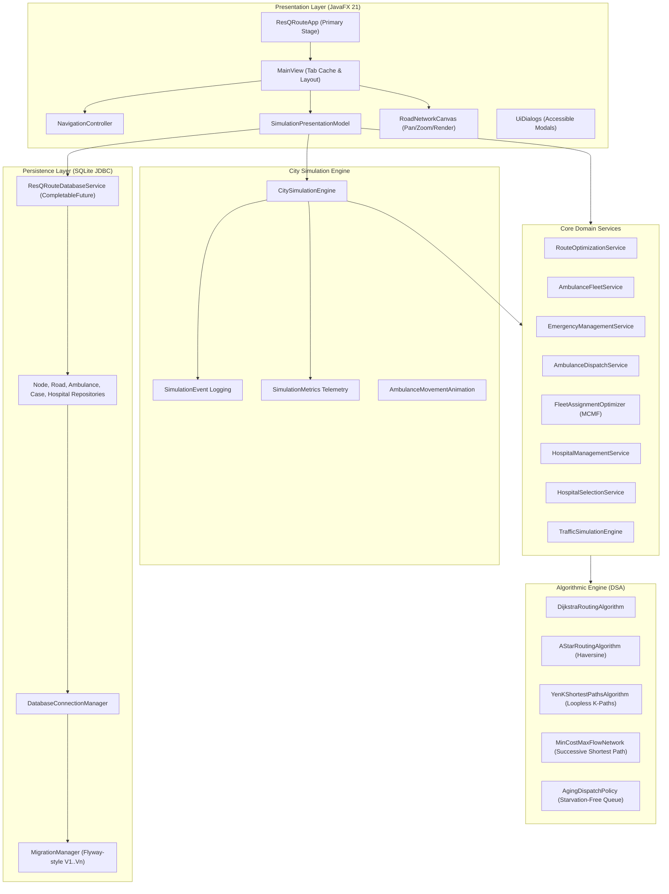

# ResQRoute — System Architecture & Algorithmic Blueprint

ResQRoute is an emergency response routing and fleet management engine built with **Java 21**, **JavaFX 21**, and **SQLite JDBC**. The system models urban road networks, dynamically tracks live traffic conditions, calculates optimal and alternative emergency routes, dispatches ambulances using queue-aging and flow-based optimization, and evaluates regional hospital capacities in real time.

---

## 1. System Architecture

The application adopts a clean, layered architecture separating core graph/routing data structures from domain services, simulation engines, persistence, and JavaFX presentation components.



---

## 2. Emergency Routing & Dispatch Workflow

When an emergency call is reported, the system transitions through triage classification, priority queue insertion, fleet matching, hospital selection, and dynamic transit monitoring.

```mermaid
sequenceDiagram
    autonumber
    actor Dispatcher as Emergency Dispatcher
    participant Model as SimulationPresentationModel
    participant EMS as EmergencyManagementService
    participant Queue as EmergencyDispatchQueueService
    participant Opt as FleetAssignmentOptimizer / Dispatcher
    participant Router as RouteOptimizationService
    participant Hosp as HospitalSelectionService
    participant Sim as CitySimulationEngine

    Dispatcher->>Model: Report Incident (Node, Severity, Type)
    Model->>EMS: createCase(EmergencyCase)
    EMS->>Queue: enqueue(case) [Computes Aging Dynamic Priority]
    Note over Queue: Aging formula: basePriority + (waitTimeSeconds * agingRate)

    alt Fleet-Wide Optimization Mode (MCMF)
        Model->>Opt: computeOptimalPlan(emergencies, ambulances)
        Opt->>Router: Compute shortest travel times (Dijkstra/A*)
        Opt->>Opt: Solve Min-Cost Max-Flow on Bipartite Network
        Opt-->>Model: Global Optimal Assignment Plan
    else Greedy Sequential Mode
        Model->>Opt: dispatchNext()
        Opt->>Queue: pollNext()
        Opt->>Router: Find nearest capable available ambulance
        Opt-->>Model: Assigned Ambulance ID
    end

    Model->>Hosp: evaluateHospitals(emergencyCase, pickupNode)
    Hosp->>Router: Calculate travel times to candidate hospitals
    Hosp-->>Model: Best Hospital (Matching ER/Trauma capabilities + Free beds)

    Model->>Sim: Register Active Mission Route
    loop Discrete Simulation Ticks
        Sim->>Sim: Advance clock & interpolate marker coordinates
        alt Road Closure Detected
            Sim->>Router: Calculate Detour / Reroute
            Router-->>Sim: Updated Optimal Route
        end
    end
    Sim->>EMS: Mark Completed & Free Bed/Vehicle
```

---

## 3. Implemented Algorithms & Complexity

### 3.1 Dijkstra's Routing Algorithm
- **Role:** Computes single-source shortest/fastest paths on directed graphs with non-negative road travel time edge weights.
- **Data Structure:** `PriorityQueue<NodeEntry>` with travel time keys and predecessor tracking map.
- **Time Complexity:** $O((|E| + |V|) \log |V|)$
- **Space Complexity:** $O(|V|)$

### 3.2 A* Routing Algorithm (Haversine Heuristic)
- **Role:** Accelerates point-to-point goal-directed routing searches using geographic coordinates.
- **Heuristic Function:**
  $$h(n) = \frac{\text{haversineDistance}(n, \text{goal})}{v_{\max}} \times 60$$
  where $v_{\max}$ is the network maximum speed limit ($80\text{ km/h}$). Because road edge distance is strictly $\ge$ straight-line Haversine distance, $h(n)$ is **provably admissible** ($h(n) \le h^*(n)$) and **consistent**, guaranteeing 100% optimal route cost identical to Dijkstra.
- **Time Complexity:** $O((|E| + |V|) \log |V|)$ worst-case; explores significantly fewer nodes in practice.

### 3.3 Yen's K-Shortest Loopless Paths Algorithm
- **Role:** Generates $K$ alternative routes when primary highways are congested or at risk of closure.
- **Mechanism:**
  1. Computes the optimal path $A_0$ using Dijkstra.
  2. Iteratively selects spur nodes $v \in A_{k-1}$ and temporarily suppresses preceding sub-paths and outgoing edges to force alternative route exploration.
  3. Maintains a candidate deviation heap $B$ and extracts the lowest-cost loopless alternative.
- **Time Complexity:** $O(K \cdot |V| (|E| + |V| \log |V|))$
- **Space Complexity:** $O(K \cdot |V|)$

### 3.4 Fleet Assignment Optimization (Min-Cost Max-Flow)
- **Role:** Resolves fleet contention when multiple high-severity emergencies compete for specialized ambulances (ALS, Cardiac, Heavy Rescue).
- **Network Flow Formulation:**
  - Source node $S \to$ Emergency Cases (capacity 1, cost 0).
  - Emergency Cases $\to$ Capable Ambulances (capacity 1, cost = weighted priority travel time).
  - Ambulances $\to$ Sink node $T$ (capacity 1, cost 0).
- **Algorithm:** Successive Shortest Path with Bellman-Ford/SPFA potential updates.
- **Optimality:** Yields lower global response time than greedy dispatch.

### 3.5 Aging Priority Queue (`AgingDispatchPolicy`)
- **Role:** Prioritizes incidents by severity while eliminating starvation for lower-severity cases waiting in queue.
- **Dynamic Priority Formula:**
  $$\text{EffectivePriority}(t) = \text{BaseSeverityWeight} + \left( \frac{t - t_{\text{reported}}}{60} \right) \times \text{AgingRate}$$

---

## 4. Database Persistence & Relational Schema

ResQRoute uses SQLite through the official `sqlite-jdbc` driver. All operations enforce foreign key constraints (`PRAGMA foreign_keys = ON;`) and execute within ACID transaction boundaries.

```
+------------------+         1:N         +------------------+
|    road_nodes    |<--------------------|      roads       |
+------------------+                     +------------------+
| id (PK)          |                     | id (PK)          |
| name             |                     | source_node_id   |
| latitude         |                     | dest_node_id     |
| longitude        |                     | distance_km      |
+------------------+                     | travel_time_min  |
        ^                                | is_available     |
        |                                +------------------+
        | 1:N
+------------------+         1:N         +------------------+
|    ambulances    |<--------------------| emergency_cases  |
+------------------+                     +------------------+
| id (PK)          |                     | id (PK)          |
| location_node_id |                     | type, severity   |
| status           |                     | pickup_node_id   |
| assigned_case_id |                     | status           |
| capabilities     |                     | assigned_amb_id  |
+------------------+                     | dest_hospital_id |
                                         +------------------+
                                                  |
                                                  | N:1
+------------------+                              v
|    hospitals     |<-----------------------------+
+------------------+
| id (PK)          |
| name, node_id    |
| total_capacity   |
| occupied_capacity|
| supported_types  |
| capabilities     |
+------------------+
```

### Schema Features:
1. **Versioned Migrations:** Managed by `MigrationManager` applying versioned SQL files (`V1__initial_schema.sql`).
2. **Asynchronous Non-Blocking Execution:** `ResQRouteDatabaseService` wraps blocking JDBC calls in dedicated `CompletableFuture` executor pools, ensuring zero JavaFX Application Thread lag.
3. **Data Integrity:** `CHECK` constraints on coordinates, capacity ranges, and non-negative travel times.

---

## 5. Build, Test & Benchmark Commands

```bash
# 1. Clean build and run complete test suite (464 tests)
mvn clean test

# 2. Fast benchmark smoke test (< 2 seconds)
mvn test-compile "exec:java" "-Dexec.classpathScope=test" "-Dexec.mainClass=com.resqroute.benchmark.BenchmarkRunner" "-Dexec.args=--smoke"

# 3. Full statistical benchmark across Small, Medium, and Large networks
mvn test-compile "exec:java" "-Dexec.classpathScope=test" "-Dexec.mainClass=com.resqroute.benchmark.BenchmarkRunner"

# 4. Launch interactive JavaFX Desktop Application
mvn clean compile javafx:run
```
